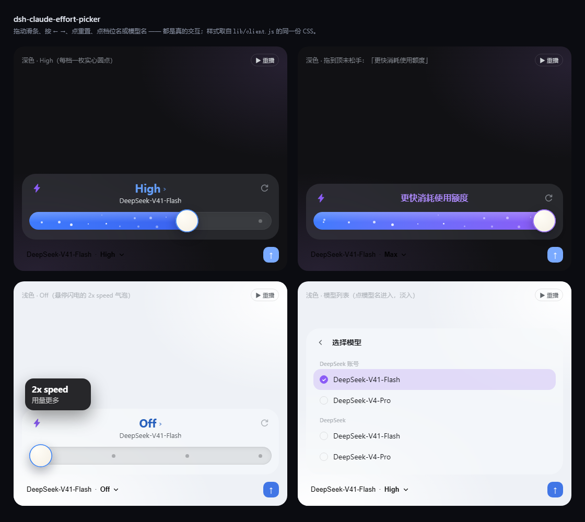

# dsh-claude-effort-picker

**DeepSeek Harness's Claude reasoning-effort slider** · DeepSeek Harness 的 Claude 风格推理等级滑动条

[](https://github.com/eggypartyYYDS/dsh-claude-effort-picker/actions/workflows/test.yml)
[](LICENSE)

给 [DeepSeek Harness](https://github.com/deepseek-ai/deepseek-harness)（DSH）用的 **Claude 风格推理等级滑条**。

把输入框工具行里那枚「模型 · 推理等级」按钮换成一条**胖胶囊滑条**：左边一枚小闪电（可点但只是摆设，
点亮时浮出 `2x speed / 用量更多` 气泡并给圆点加速），中间是当前档位的大字与它下面的模型名，右边是**重置**按钮，
下面一条轨道 —— High 及以下纯蓝、往最高档渐变到紫，每个等级一枚实心圆点，右端是奶油色大旋钮。



---

## 它长什么样

```
输入框工具行                                点开之后
┌──────────────────────────────┐      ┌────────────────────────────────────────┐
│ DeepSeek-V41-Flash · High ⌄  │      │⚡        High ›                ↺      │
└──────────────────────────────┘      │        DeepSeek-V41-Flash              │
                                      │ ●━━━━━━━━━━━━━━━━━━━●              ·   │
                                      │  ✦   ✧    ✦      ✧    ✦              │
                                      └────────────────────────────────────────┘
                                          ↑ 每档一枚实心圆点，填充层会把它们盖住
```

- **⚡ 可点，但只是摆设**：是一枚真正的 `<button>`（可悬停、可聚焦、可点、有 `:active` 回弹）。
  点一下它**点亮**（实心紫底 + 白色闪电），同时收起态胶囊前出现一枚 `⚡` 徽章；再点熄灭。
  **它不会把档位跳到 Max，也不写库**，而且这个点亮状态与当前档位无关 —— 掉到 Max 以下也不会消失。
  悬停或聚焦时浮出 `2x speed` + `用量更多` 气泡。
- **颜色**：**High 及以下整条都是蓝色**；从 **High 到 Ultimate（最高档）之间是一条渐变带** ——
  拖到哪，档位大字、轨道右端、旋钮描边就混合到哪（0% 蓝 → 100% 紫），到顶才是纯紫。
  胶囊里的档位名只在最高档变紫，其余为**灰色**（这一处是硬切，不掺混）。
- **轨道里只有圆球**：16 颗大小/高度/透明度/相位都不规则的**实心圆点**，持续**向右流动**（不是星星，也不再闪）。
  流速 = 1×（High 及以下）→ **1.5×**（最高档 **或** 点亮闪电）→ **2×**（最高档 + 点亮闪电）。
  变速走的是**动画播放速率**（`updatePlaybackRate`），不是改时长 —— 所以切档/点闪电时圆球只是**加速**，
  不会跳相位、不会抽一下。点亮闪电只改流速，仍然**不改档位、不写库**。
- **高度会自己"呼吸"**：任何内容变化（切到档位/模型列表、出现"更快消耗使用额度"、错误条、搜索框）
  都会把卡片**从当前高度过渡到新高度**（0.32s）。所以到顶显示提示时卡片会**收窄**，提示淡出后再**长回来**，
  切换列表也是同一个动效，不会硬切。
- **标题区用同一套动画**：`更快消耗使用额度` ↔ `档位 + 模型名` 的互换，和"滑条 ↔ 档位列表 ↔ 模型列表"
  用的是**同一个淡入曲线**（`cep-viewIn`，0.22s，上移 5px 淡入），并且触发同一次高度过渡 ——
  两个方向都有动画，不会一边淡入一边硬切。
- **展开动画**：打开时卡片从输入框那一角**展开**（`transform-origin: right bottom`，0.38s，从 0.8 倍
  放大 + 上移淡入），高度同时从头部的高度**长到完整高度**（0.26s 缓动），不是"啪"地弹出来。
- **↺ 重置**：直接把推理等级切回该模型的 `Off` 档（模型没有 Off 时取最低档）。
- **档位大字**：跟着旋钮实时变化；点它（或滑条上按 `Enter`）展开档位列表，挑一档即回到滑条。
- **模型名**：点它进入模型列表（按 provider 分组、单选圆点、>4 个出搜索），选完即生效并收起。
- **拖到顶**：还没松手时，标题位置换成 **「更快消耗使用额度」**；松手后保留 1.2 秒再淡回档位名。
- **落格**：松手即吸附到最近的一档，旋钮与填充用 0.2s 曲线滑到格上；写库在途时旋钮**停在**松手的位置
  （不会先弹回旧档再跳过去）。

## 交互细节

| 操作 | 结果 |
|---|---|
| 点胶囊 / 点 `/model` | 展开滑条卡片，焦点落在滑条上 |
| 拖滑条 / 点轨道 | 旋钮跟手；松手吸附并写回一次（同档不重复写） |
| `←` `→` `Home` `End` | 逐档切换，到两端停住 |
| `Enter` / 点档位大字 | 展开档位列表（当前档打勾、默认档标「默认」）；`Esc` 回到滑条 |
| 点模型名 | 展开模型列表；`Esc` 或返回箭头回到滑条 |
| 点 ⚡ | 点亮/熄灭（纯视觉）+ 胶囊出现/收起 `⚡` 徽章 + 圆球流速 +0.5×；不改档位、不写库 |
| 点 ↺ | 切回 `Off` |
| `Esc` / 点卡片外 | 关闭并把焦点还给胶囊 |

视图切换（滑条 ↔ 档位列表 ↔ 模型列表）有**淡入**；卡片高度**渐变**（以底边为锚，向上长/缩），
打开时也是**展开**而不是弹出。写回统一走官方的 `session.selectModel`，在途状态由官方的 `pending`
显示为右上角与胶囊里的转圈。

## 安装

### A. DSH Desktop 插件面板（推荐）

**设置 → 插件 → 添加插件**，填下面任意一种，安装后**完全退出并重开** DSH Desktop：

- `github:eggypartyYYDS/dsh-claude-effort-picker`（从 GitHub 拉取，需要本机能访问 github.com）
- 或本地目录的绝对路径（克隆/解压后的那一层，例如 `D:\deepseekHarness Claude`）

> `desktop` profile 由 Electron 独占管理，命令行 `dsh plugin --profile desktop add …` 会被拒绝。

### B. 命令行（非 `desktop` profile）

```powershell
dsh plugin --profile <profile> add github:eggypartyYYDS/dsh-claude-effort-picker
```

### C. 手动安装（面板不可用时）

1. `~/.dsh/profiles/<profile>/package.json` 的 `dependencies` 加
   `"dsh-claude-effort-picker": "link:<本目录绝对路径>"`；
2. 在 `profiles/<profile>/node_modules/` 下建指向本目录的 junction（Windows）或符号链接；
3. `profiles/<profile>/cordis.patch.yml` 里加：

   ```yaml
   - insert:
       - id: claude-effort-picker
         name: dsh-claude-effort-picker
   ```

4. 完全退出并重开。

### 卸载

面板里关闭/卸载即可。手动装的把上面三步反过来；Windows 下删 junction 用
`cmd /c rmdir <junction>`，**不要**用 `Remove-Item -Recurse`（它会顺着链接删掉插件本体）。

## 它怎么工作

| 半边 | 作用 |
|---|---|
| `lib/index.js`（宿主） | 空的 `apply`。唯一作用是让本包成为 cordis 树上的一行——只有这样 `dsh.client` 声明的客户端 bundle 才会被扫进启动图 |
| `lib/client.js`（浏览器） | 注册 `conversation.input.model` 席位 + 把 `/model` 指向同一张卡片 |

- **席位遮蔽**：`conversation.input.model` 是 `single` 槽位，「同一 priority 只能有一个占用者，priority 最低者渲染」。
  本插件以 **priority `-10`** 注册，盖住官方 `ui-model-selection` 的席位（priority `0`）——
  不修改、不依赖官方 DOM，禁用本插件后官方席位原样回来。
  窄到放不下时按官方约定折叠：文案层读 `--dsh-composer-model-text-display`，
  图标层读 `--dsh-composer-model-icon-display`。
- **`/model` 重定向**：官方 `/model` 是 `ctx.commandUi` 里的一个 `popupSelect` 贡献。插件把它的 `ui`
  换成 action，由它通知「当前会话已挂载的席位」展开卡片；插件卸载时把原对象还回去。换不动就**什么都不做**。
- **数据面**：只读官方公开面——`ctx.modelDirectories.directoryFor(sessionId).store`（快照 + `subscribe`）
  与 `directory.select(selection)`，加上 `ctx.sessions.subagentAddress()` 判断可用性。
  不注册宿主钩子、不发消息、不写会话日志。
- **零依赖**：`react` / `react-dom` 走宿主模块表的平台种子词；闪电、箭头、重置、勾、星尘都是自绘 SVG / CSS。

## 稳健性

- **切换会话 / 工作区不会掉**：席位注入面是**懒解析**的 —— 会话作用域还没挂好时不抛错，先渲染
  「正在加载…」，再自动重试（最多 40 次 × 120ms）；作用域换了（binding 变更）会重新解析。
  这一点很重要：渲染层把「条目抛错」当作弃权，一旦弃权，插件会整场会话失效，直到你手动关开插件。
- **fail-open**：取不到目录、`/model` 结构变化、主题令牌缺失——都只影响本插件自己；
  尺寸动画那几行命令式 DOM 也包在 try/catch 里，失败只是不做过渡。
- **写失败如实上报**：`select()` 返回 `{ok:false}` 或抛错时卡片内出现红色说明条
  （`session/writer-held` 翻成「会话正被其他 DSH 实例占用…」），并把乐观位置撤回；
  模型切换失败会把卡片重新打开，不会静默。
- **不静默降级**：模型没有推理等级就不画滑条，改成一句说明，档位大字与重置一起置灰。
- **可访问性**：胶囊 `aria-haspopup="dialog"` + `aria-expanded` + `aria-controls`；卡片 `role="dialog"`；
  滑条 `role="slider"` + `aria-valuemin/max/now/valuetext`；列表行 `role="menuitemradio"` + `aria-checked`；
  闪电是装饰（`aria-hidden`），信息在它的 `title` 与气泡里。
- **减少动态效果**：`prefers-reduced-motion` 下关掉入场/淡入/尺寸过渡与旋钮缩放，星尘停止闪烁（保持可见）。

## 已知限制

- 需要**重启 DSH Desktop** 才生效（客户端 bundle 在启动时注入）。
- 卡片替代了官方席位的展现，官方那套「模型 / 推理等级两级下钻菜单」在启用期间不出现；禁用即恢复。
- 模型没有描述字段（DSH 目录不提供），列表只有名字。
- `2x speed` 只是装饰文案：DSH 没有可切换的「快速模式」，真正的档位由滑条与重置决定。

## 开发

零构建步骤：`lib/client.js` 就是发布产物（手写、可读）。

```powershell
node test/client.test.mjs        # 52 条离线断言：几何/吸附/圆点/颜色混合/变速不重置/高度过渡/乐观位置/装饰闪电/重置
node preview/build-preview.mjs   # 生成 preview/panel.html（CSS 与星尘都从 lib/client.js 里抽，不会漂移）
```

`test/` 里没有真 React：一个按实例保存 hook 表的小桩件 + 够用的假 DOM，
但跑的是**真的 client.js**（`window.__ModuleLoader__.load` → `factory(require)`）。
所有开发与上传（包括这个README.md）均由DeepSeek HARNESS独立完成，没有人工修改。
制作by deepseek harness&哔哩哔哩 爱玩windows的system

## 许可

**自定义许可：非商业 + 强制署名**（[LICENSE](LICENSE)，中文为权威文本，英文为参考译本）。
Copyright (C) 2026 `eggypartyYYDS <yyds2458@outlook.com>`。

| ✅ 可以（免费） | ❌ 不可以（需单独授权） |
|---|---|
| 下载、安装、运行 | 任何**商业使用**：销售、付费下载/订阅、作为付费产品或收费服务的一部分、以营利为目的的生产经营、以广告/引流变现的托管 |
| 个人学习、研究、教学、非营利项目 | 移除、改写或隐藏原作者署名与版权声明 |
| 修改、制作衍生作品、免费再分发 | 把修改版说成原作者发布，或以"原创"名义单独发布 |
| 在保留许可与署名的前提下随其它非商业项目一起分发 | 改用其它协议再分发（衍生作品必须沿用本许可） |

- **署名怎么做**：保留 LICENSE 全文、版权声明与项目地址；并在显眼处（README / 致谢页 / 发布说明）写明
  「基于 eggypartyYYDS 的 DSH Claude 推理等级滑条」+ `https://github.com/eggypartyYYDS/dsh-claude-effort-picker`；
  改过的版本还要注明"已修改"。
- **商业授权**：联系 `yyds2458@outlook.com` 单独洽谈。
- 因为含"禁止商业使用"，这**不是** OSI 认可的开源许可，GitHub 的许可证栏会显示 **Other** —— 这是正常的，
  文件本身完整有效。`package.json` 用 npm 的规范写法 `"license": "SEE LICENSE IN LICENSE"`。
- 图标、圆点、动画均为自绘，无第三方素材。
